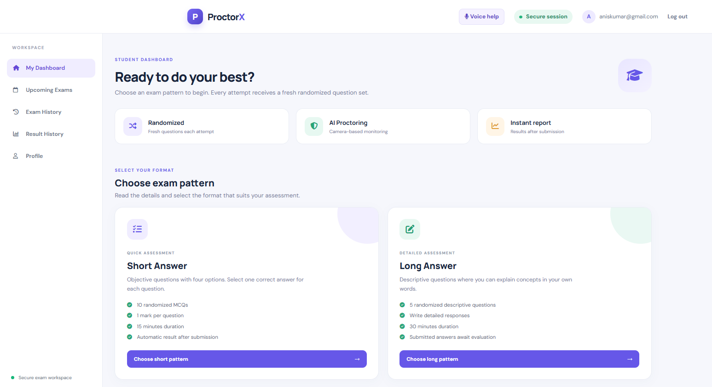
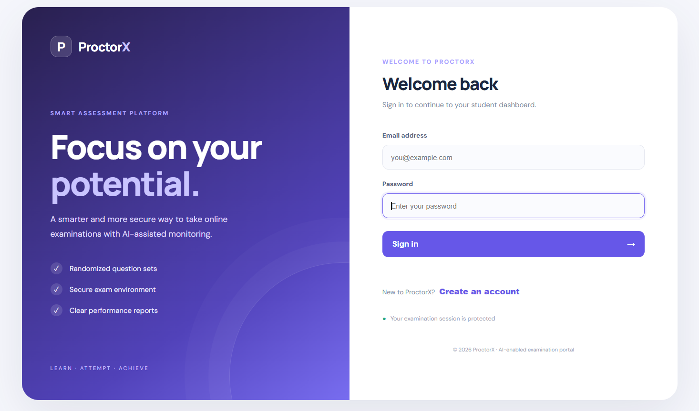

# ProctorX – AI-Based Online Exam Proctoring System

An intelligent online examination platform designed to conduct secure, reliable, and transparent online assessments using Artificial Intelligence and Computer Vision.

ProctorX combines an examination portal with AI-powered monitoring features to help detect suspicious activities during online examinations. It provides a structured examination environment, automated MCQ evaluation, descriptive answer submission, and activity monitoring.

---

## 📸 ProctorX Dashboard Preview



---

## 🔐 ProctorX Login Page Preview



---

## About the Project

**ProctorX** is an AI-based online examination and proctoring system developed to improve the security and integrity of online assessments.

The system monitors candidates during examinations using computer vision and audio-based detection techniques. It identifies potentially suspicious activities and maintains activity records that can be reviewed after the examination.

The platform also provides separate examination patterns for objective and descriptive assessments, along with examination timers, result management, and student account functionality.

---

## Key Features

### 1. Online Examination System

- Student registration and login.
- Examination dashboard.
- Short Answer and Long Answer examination patterns.
- Multiple-choice questions.
- Descriptive answer submission.
- Examination countdown timer.
- Automatic submission when the timer expires.

### 2. AI-Based Proctoring

- Face detection using Dlib.
- Eye gaze detection.
- Mouth tracking.
- Blink detection.
- Head pose estimation.
- Object detection using YOLO.
- Audio activity detection.

### 3. Examination Monitoring

- Candidate activity monitoring.
- Suspicious activity detection.
- Examination violation tracking.
- Activity logging.
- Examination history management.

### 4. Student Dashboard

- Student profile management.
- Examination history.
- Result information.
- Account password management.
- Examination status monitoring.

---

## Technologies Used

| Category | Technologies |
|---|---|
| Programming Language | Python |
| Frontend | HTML, CSS, JavaScript |
| Backend | Flask |
| Computer Vision | OpenCV, Dlib |
| Object Detection | YOLO |
| Audio Processing | PyAudio, Winsound |
| Database | MySQL |
| Development Tools | VS Code, Git, GitHub |

---

## Project Structure

```text
ProctorX/
│
├── backend/
│   └── db_helper.py
│
├── config/
│   └── Configuration files
│
├── object_detection_model/
│   └── YOLO model files
│
├── shape_predictor_model/
│   └── Dlib landmark model
│
├── static/
│   ├── css/
│   ├── js/
│   └── images/
│       ├── dashboard.png
│       └── login.png
│
├── templates/
│   ├── index.html
│   └── quiz.html
│
├── server.py
├── app.py
├── requirements.txt
├── .gitignore
└── README.md
```

*Note: This is a simplified project structure. Additional files and folders may exist in the repository.*

---

## Installation and Setup

### Step 1: Clone the Repository

```bash
git clone https://github.com/anis2000panigrahi-bit/ProctorX-AI-Based-Online-Exam-Proctoring-System-Project.git
```

### Step 2: Open the Project Folder

```bash
cd ProctorX-AI-Based-Online-Exam-Proctoring-System-Project
```

### Step 3: Create a Virtual Environment

```bash
python -m venv .venv
```

### Step 4: Activate the Virtual Environment

For Windows PowerShell:

```powershell
.venv\Scripts\Activate.ps1
```

### Step 5: Install Dependencies

```bash
pip install -r requirements.txt
```

### Step 6: Configure Environment Variables

Create a `.env` file in the project directory and configure the required environment variables.

Example:

```env
FLASK_SECRET_KEY=your_secret_key
DB_HOST=localhost
DB_USER=root
DB_PASSWORD=your_database_password
DB_NAME=your_database_name
```

Use the configuration names required by your application.

**Important:** Never upload actual database passwords, API keys, secret keys, or private credentials to GitHub.

### Step 7: Configure the Database

- Install and start MySQL.
- Create the required database.
- Configure your database connection.
- Ensure the required database tables are available.

### Step 8: Run the Application

```bash
python server.py
```

Open your browser and visit:

```text
http://127.0.0.1:5000/
```

---

## How to Use

1. Open the ProctorX application.
2. Register a student account or log in.
3. Access the examination dashboard.
4. Select the required examination pattern.
5. Read the examination instructions.
6. Start the examination.
7. Complete the questions within the given time.
8. Submit the examination.
9. Review the available results and examination history.

---

## Activity Monitoring

During an examination, the proctoring system monitors candidate activity using supported computer vision and audio detection modules.

Detected activities can be recorded in an activity log for further review.

Automated detections should be reviewed carefully and should not be treated as definitive proof of misconduct.

---

## Future Enhancements

- Advanced AI-based suspicious activity detection.
- Improved face recognition and candidate verification.
- Enhanced examination analytics.
- Advanced student performance reports.
- Cloud-based examination deployment.
- Improved real-time monitoring dashboard.

---

## Developer

**Anis Kumar Panigrahi**

B.Tech – Computer Science and Engineering  
Gandhi Engineering College, Bhubaneswar, Odisha, India.

### Connect With Me

- **LinkedIn:** [Anis Kumar Panigrahi](https://www.linkedin.com/in/aniskumarpanigrahi/)
- **GitHub:** [anis2000panigrahi-bit](https://github.com/anis2000panigrahi-bit)
- **Instagram:** [anis_panigrahi.2545](https://www.instagram.com/anis_panigrahi.2545/)

---

## Acknowledgement

This project is based on and developed with reference to existing work in AI-based online examination proctoring.

Original project credits and applicable third-party licenses should be retained according to their respective licensing requirements.

---

## License

Please refer to the original project's license and applicable third-party licenses before redistributing or modifying this project.

---

⭐ If you find this project interesting, consider giving the repository a star!